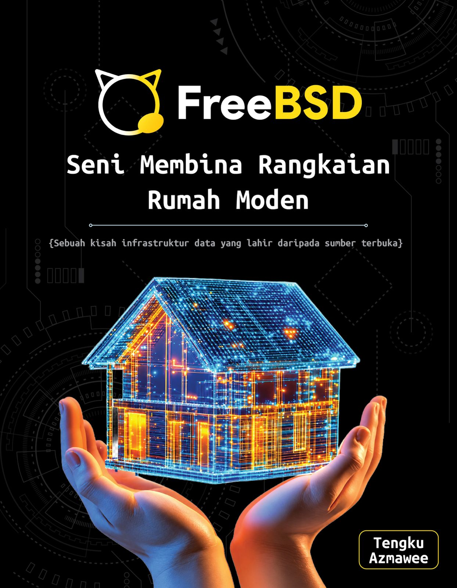
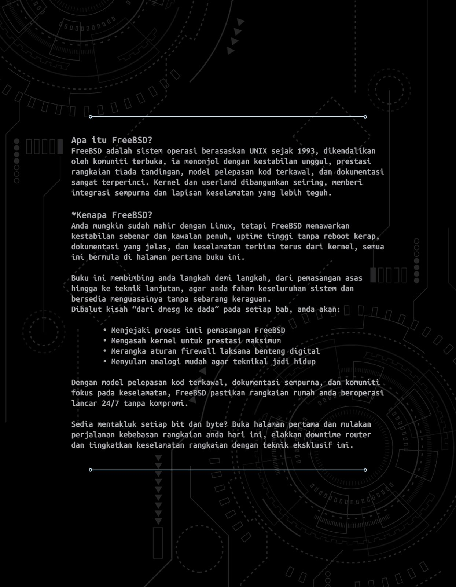

# Seni FreeBSD

Kod iringan untuk buku **FreeBSD: Seni Membina Rangkaian Rumah Moden** oleh Tengku Azmawee.

Buku ini merekodkan pembinaan rangkaian rumah moden menggunakan FreeBSD, dari pemasangan sistem sehingga servis harian. Repo ini mengandungi contoh konfigurasi dan skrip sebenar yang digunakan dalam buku, bukan sekadar teori.

## Status buku

- Status: Dalam semakan akhir
- Bab: 30 bab + 1 bonus
- Format: Novel teknikal
- Bahasa: Melayu
- Pengarang: Tengku Azmawee

## Kulit buku

### Depan



### Belakang



## Sorotan bab

- 01 - Pengembaraan Bermula: Dari JARING ke FreeBSD
- 06 - Dari Legasi Lama Ke Kuasa Baru: Evolusi PPPoE
- 11 - Gelombang Tak Terlihat: Seni Menyusun Wi-Fi
- 12 - Encrypted DNS: Privasi Sebelum Klik Pertama
- 13 - AdGuard Home: Seni Bertahan Dalam Senyap
- 17 - Disk Berganda, Tenang di Hati: Software RAID
- 19 - Rumah Jadi Awan: NAS, Nextcloud, dan Rclone
- 24 - Mesin Dalam Mesin: Bhyve dan Windows 10 LTSC
- 29 - Benteng Tak Terlihat: Menghadang Serangan Cyber
- 30 - Komuniti Open Source Malaysia: Dari MYBSD ke Rawsec

## Kandungan repo

```text
configs/
├── firewall/   # PF, SEC, miniUPnP
├── pppoe/      # PPPoE/mpd5, ppp, dhcp6c, ip-up/ip-down
├── web/        # Apache httpd
├── samba/      # Samba
└── system/     # rc.conf, sysctl.conf
scripts/        # cloudflare-ddns.sh, config_backup.sh
```

## Cara guna

1. Baca bab berkaitan dalam buku.
2. Salin fail contoh ke sistem.
3. Tukar interface, IP, domain, token dan laluan mengikut rangkaian sendiri.
4. Uji konfigurasi sebelum reload servis.

## Nota

Semua fail adalah contoh untuk rujukan. Nilai seperti interface, IP, laluan dan kredensial perlu disesuaikan dengan rangkaian rumah sendiri sebelum digunakan. Kredensial dalam repo ini telah diganti dengan placeholder.

## Pautan

- Buku: https://seni.freebsd.my/
- Penulis: [azmawee.github.io](https://azmawee.github.io)
- Facebook: [facebook.com/maui512gbram](https://facebook.com/maui512gbram)
